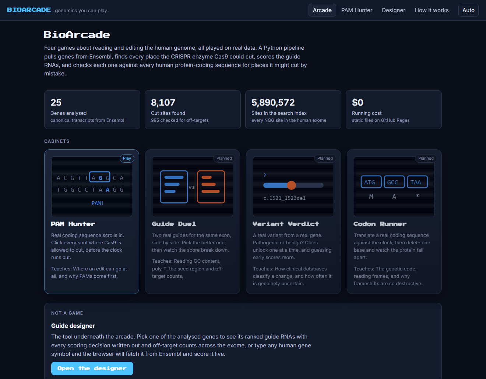
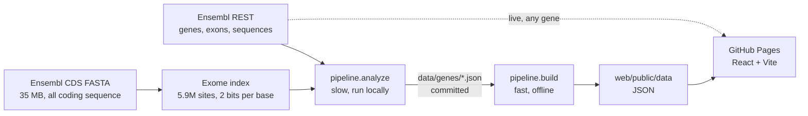

# BioArcade

Genomics you can play. Four arcade games about reading and editing the human genome, plus the CRISPR guide designer
that feeds them. Every sequence on the site is real: a Python pipeline pulls genes from Ensembl, finds every place the
Cas9 enzyme could cut, scores the guide RNAs against published design rules, and checks each one for look-alike sites
across the whole human exome.

**Live:** https://arthurgaspar.github.io/bioarcade/



## What's here

| | |
|---|---|
| **PAM Hunter** (playable) | Real coding sequence appears; click every spot where Cas9 is allowed to cut, before the timer runs out. Teaches why PAM sites decide where an edit can go at all. |
| **Guide Duel** (planned) | Two real guides for the same exon. Pick the better one, then see the score break down. |
| **Variant Verdict** (planned) | A real variant: pathogenic or benign? Clues unlock one at a time. |
| **Codon Runner** (planned) | Translate real coding sequence against the clock, then delete one base and watch the protein fall apart. |
| **Guide designer** | The tool underneath. 25 analysed genes with ranked guides, every scoring decision written out, and off-target counts; or type any human gene and the browser fetches and scores it live. |

## Numbers from the current build

| | |
|---|---|
| Genes analysed | 25, canonical GRCh38 transcripts |
| Cut sites found | 8,107 in coding sequence (median 196 per gene) |
| Guides checked for off-targets | 995 (the 40 best-scoring per gene) |
| Search index | 5,890,572 sites: every NGG-adjacent 20-mer in all human protein-coding sequence, both strands |
| Guides that are clean | 17 to 40 per gene, meaning score 75+ and specificity 95+ |
| Site weight | 411 KB of JSON, served as static files |

## How it is checked

The coordinate maths is the part most likely to be quietly wrong: exons come back in genomic coordinates, but a gene on
the minus strand reads right to left, and only part of each exon is translated. The test is that the assembled coding
sequence must start with methionine, end with a stop codon, and divide evenly into codons. It does, for all 25 genes,
and the protein lengths match the published ones (TP53 393 aa, CFTR 1480, BRCA1 1863, DMD 3685).

The browser scores live-fetched genes in TypeScript while the pipeline scores the analysed ones in Python. Two
implementations of the same rules will drift, so a test re-scores **every published guide** with the TypeScript code and
requires identical scores and identical wording. 37 tests in total: 25 in Python, 12 in TypeScript.

## Architecture



The slow half runs on your machine and its results are committed, so CI only runs the fast half. Nothing here costs
money: Ensembl is free and needs no key, GitHub Actions builds the site, and Pages serves it.

## Run it

```bash
python -m venv .venv
.venv/Scripts/activate             # Windows; `source .venv/bin/activate` elsewhere
pip install -r requirements.txt

python -m pipeline.build           # site data from the committed analyses (instant)
python -m pytest                   # pipeline tests

cd web && npm install
npm test                           # includes the Python/TypeScript parity check
npm run dev
```

To re-analyse the genes (needs the network, downloads 35 MB, and takes about four minutes to index the exome plus a few
minutes of Ensembl fetches):

```bash
python -m pipeline.analyze --refresh
```

Add a gene by putting it in `pipeline/catalog.py` and running `python -m pipeline.analyze`.

## Limits worth knowing

- **This is a teaching toy, not a lab tool.** Real work uses trained efficiency models, genome-wide off-target searches,
  and validation in cells.
- **Off-target search covers coding sequence only.** Most of the genome is non-coding and a guide can cut there too, so
  the counts are a floor, not a total.
- **Spliced sequence creates a few sites that do not exist** in the genome, where the index joins two exons.
- **Guides that reach past the coding region** into a UTR or intron are absent from the index; they are flagged and
  their specificity number should be ignored.
- **One transcript per gene.** Alternative splicing is ignored.

## Sources

- Genes, transcripts and sequences: [Ensembl REST](https://rest.ensembl.org), GRCh38.
- Off-target reference: [Ensembl human CDS FASTA](https://ftp.ensembl.org/pub/current_fasta/homo_sapiens/cds/).

Ensembl data is free to use with attribution.
